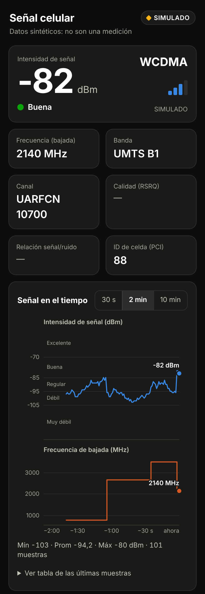
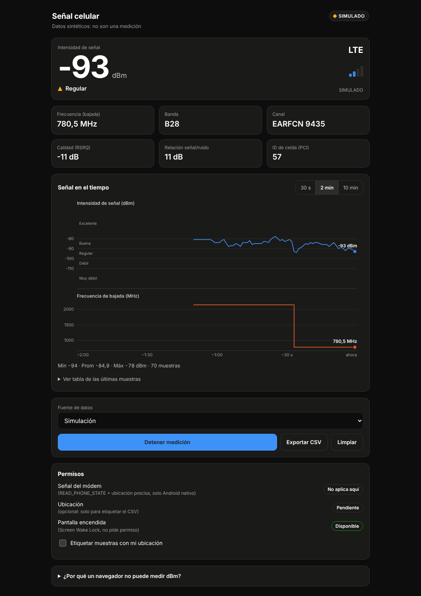

# Señal celular en vivo (dBm + frecuencia)

Interfaz web con gráficas en tiempo real para la intensidad de señal (dBm) y la frecuencia de bajada de la celda que sirve al teléfono, más un plugin nativo de Android que lee el módem.

> **Resumen honesto:** ningún navegador (Chrome, Safari, Firefox…) puede leer dBm ni frecuencia del módem celular. Ni siquiera como PWA instalada. Para medirlos de verdad hace falta una app nativa. La solución propuesta es **reutilizar esta misma interfaz web dentro de un contenedor Capacitor en Android**, con un plugin que lee `TelephonyManager`. En iPhone no es posible obtener dBm celular con APIs públicas.

<p align="center">
  
  &nbsp;
  
</p>
<p align="center"><sub>Capturas con datos <b>simulados</b> (el modo de demostración de la interfaz).</sub></p>

---

## 1. Qué puede y qué no puede hacer cada plataforma

| Dato | Navegador Chromium en Android | Safari / iOS | Firefox | App nativa Android | App nativa iOS |
|---|---|---|---|---|---|
| Potencia recibida (dBm: RSRP / RSSI) | ❌ | ❌ | ❌ | ✅ `TelephonyManager` / `CellInfo` | ❌ (sin API pública) |
| Canal / frecuencia (EARFCN → MHz) | ❌ | ❌ | ❌ | ✅ `CellIdentity*` | ❌ |
| Tecnología real (2G/3G/4G/5G) | ❌ solo una *categoría* estimada (`effectiveType`) | ❌ | ❌ | ✅ | ✅ solo la tecnología (`CTTelephonyNetworkInfo`) |
| Latencia / velocidad estimadas | ✅ `navigator.connection` (valores cuantizados) | ❌ | ❌ | ✅ | ✅ midiéndolas tú |
| Tipo de enlace (`cellular`, `wifi`) | ⚠️ según versión/navegador | ❌ | ❌ | ✅ | ✅ |

Notas:

- **Network Information API** (`navigator.connection`) está marcada por MDN como de *disponibilidad limitada*: la implementan los navegadores Chromium; Safari y Firefox no. Verifica el estado actual en caniuse antes de depender de ella. Aunque exista, solo da `effectiveType` (`"4g"` es una categoría de rendimiento calculada con latencia y ancho de banda, **no** la tecnología de radio), `downlink`, `rtt` y `saveData`. Nada de potencia ni frecuencia.
- **Web Bluetooth** expone RSSI de dispositivos BLE cercanos, no de la antena celular. **Generic Sensor / Geolocation / Wake Lock** no tienen relación con el módem.
- **iOS:** CoreTelephony solo informa la tecnología de acceso radio y datos del operador. La potencia en dBm solo se ve en el modo de pruebas del sistema (marcar `*3001#12345#*`, según modelo y versión), pero ninguna app puede leerla, y las APIs privadas que lo permitirían no pasan App Store.
- **PWA ≠ solución.** Una PWA hace la interfaz instalable y funcional sin conexión, pero corre en el mismo sandbox del navegador: no gana acceso al hardware celular. Aquí se incluye (manifest + service worker) solo para la parte visual.

## 2. Solución técnica recomendada

```
┌──────────────────────────── App Android (Capacitor) ────────────────────────────┐
│  WebView                                                                         │
│  ┌──────────────────────────────┐  eventos "signal"   ┌───────────────────────┐ │
│  │ www/  (esta interfaz)        │ ◀────────────────── │ SignalMonitorPlugin   │ │
│  │ gráficas · permisos · CSV    │ ──── start/stop ──▶ │  (Java)               │ │
│  └──────────────────────────────┘                     │  TelephonyManager     │ │
│                                                       │  requestCellInfoUpdate│ │
│                                                       └──────────┬────────────┘ │
└──────────────────────────────────────────────────────────────────┼──────────────┘
                                                                   ▼
                                                           Módem / Radio (RIL)
```

Por qué Capacitor y no las alternativas:

| Opción | Veredicto |
|---|---|
| **Capacitor + plugin propio** ✅ | Reutiliza el 100 % de la interfaz web, un solo puente JS↔nativo documentado, build con Android Studio. |
| PWA / TWA (Trusted Web Activity) | Sigue siendo el navegador: sin puente nativo, sin dBm. |
| Servicio nativo + WebSocket en `127.0.0.1` | Funciona, pero hay dos apps que instalar, el navegador puede bloquear la conexión por contexto seguro/mixto y es más frágil. |
| WebView propio con `addJavascriptInterface` | Es lo que ya hace Capacitor, pero a mano. |
| Flutter / React Native / Kotlin puro | Válidas, pero obligan a reescribir la interfaz. |

El plugin entrega la **tecnología, dBm, RSRQ/SINR, nivel, número de canal y PCI**. La conversión canal → MHz se hace en `www/arfcn.js` (fórmulas 3GPP TS 36.101 y 38.104), con pruebas unitarias.

## 3. Estructura

```
senal-celular/
├── www/                       Interfaz web (también se abre sin Android, en simulación)
│   ├── index.html · styles.css · app.js
│   ├── chart.js               Gráfica canvas en tiempo real (sin dependencias)
│   ├── sources.js             Fuentes: Android nativo · navegador (limitado) · simulación
│   ├── permissions.js         Permisos: módem (nativo), geolocalización opcional, Wake Lock
│   ├── arfcn.js · quality.js  Canal→MHz y umbrales de calidad
│   └── manifest.webmanifest · sw.js · icons/   PWA (parte visual)
├── android-plugin/            Código nativo (Java) que el script copia al proyecto Android
├── scripts/setup-android.mjs  Genera android/, copia el plugin, añade permisos y minSdk 29
├── test/                      Pruebas de la conversión y la clasificación
├── .github/workflows/         CI, compilación del APK y demo en GitHub Pages
├── docs/                      Capturas del README
└── capacitor.config.json · package.json
```

## 4. Probar la interfaz sin teléfono

```bash
npm run dev          # sirve www/ en http://localhost:5173
npm test             # pruebas de conversión canal→MHz y calidad
```

En un navegador la app arranca en modo **Limitado** (solo latencia/velocidad estimadas) y ofrece cambiar a **Simulación**: datos sintéticos con desvanecimiento y *handovers* (cambia de celda y de frecuencia cada 20–60 s). El badge “Simulado” siempre está visible y el CSV marca `simulado=si`, para que nadie confunda esos datos con una medición.

> Hay que servirla por HTTP (no abrir `index.html` con `file://`): usa módulos ES.

## 5. Compilar la app Android (medición real)

Requisitos: Node 20+, JDK 21 y Android Studio (Capacitor 8), y un **teléfono físico** con SIM: los emuladores devuelven celdas falsas.

```bash
npm install
npm run android:setup     # genera android/, copia el plugin, añade permisos y fija minSdk 29
npm run android:open      # abre Android Studio; ejecútala en el teléfono
```

`android:setup` es idempotente y funciona igual en Windows, macOS y Linux. Si cambias `appId` en `capacitor.config.json`, ajusta también el `package` del código Java automáticamente. Cuando cambies algo en `www/`, basta con `npm run android:sync`.

Sin Android Studio puedes generar el APK desde consola con `cd android && ./gradlew assembleDebug` (en Windows, `gradlew.bat assembleDebug`); queda en `android/app/build/outputs/apk/debug/`.

El plugin está escrito en **Java** a propósito: la plantilla de Capacitor no trae Kotlin y así no hay que tocar Gradle.

### Qué hace el script a mano (por si prefieres hacerlo manualmente)

1. `npx cap add android`
2. Copiar `android-plugin/*.java` a `android/app/src/main/java/<appId como carpetas>/`
3. Pegar `android-plugin/AndroidManifest.snippet.xml` antes de `</manifest>` en `AndroidManifest.xml`
4. Subir `minSdkVersion` a 29 en `android/variables.gradle`
5. `npx cap sync android`

## 5.1 CI y demo en GitHub

| Workflow | Qué hace |
|---|---|
| `ci.yml` | En cada push: revisa la sintaxis de los módulos y corre las pruebas. |
| `android-apk.yml` | Genera `android/` con el script y compila un APK de depuración, que queda como artefacto descargable. Es también la comprobación de que el plugin Java compila. |
| `pages.yml` | Publica `www/` como demo web. Actívalo en *Settings → Pages → Source: GitHub Actions*. La demo corre en modo limitado/simulación: un navegador no lee dBm. |

## 6. Permisos

**Android nativo** (alias `signal`, lo gestiona Capacitor):

- `READ_PHONE_STATE`
- `ACCESS_FINE_LOCATION` + `ACCESS_COARSE_LOCATION`. Android trata la identidad de la celda (canal, PCI) como dato de ubicación, por eso la pide aunque la app no use GPS. Desde Android 12 hay que declarar las dos, y el usuario debe elegir **Ubicación precisa**.
- Si el usuario marca “No volver a preguntar”, Android ya no muestra el diálogo; `permissions.js` lo detecta y la app ofrece **Abrir ajustes** (`openSettings()` del plugin). Al volver de Ajustes se relee el estado automáticamente.

**Navegador** (solo extras opcionales; ninguno desbloquea la señal):

- *Geolocation*: etiqueta las filas del CSV con coordenadas. Exige HTTPS o `localhost`.
- *Screen Wake Lock*: mantiene la pantalla encendida mientras mide; se vuelve a pedir al regresar a la pestaña.

Con base en la documentación de Android que conozco, estos son los permisos que exige la lectura de celdas; no pude confirmarlos contra la referencia oficial desde aquí, así que valida el comportamiento en tu dispositivo y versión de Android.

## 7. Cómo se obtiene la “frecuencia”

El teléfono no es un analizador de espectro: Android entrega el **número de canal** de la celda que te sirve (EARFCN en 4G, NR-ARFCN en 5G, UARFCN en 3G, ARFCN en 2G). Se convierte a MHz con las fórmulas 3GPP y se muestra la **frecuencia central de bajada** de esa portadora. Casos que no resuelve y lo dice en pantalla en vez de inventar: bandas 4G fuera de la tabla incluida, y ARFCN 2G 512–810 (ambiguo entre DCS 1800 y PCS 1900). En 5G la banda (n78, n41…) no se deduce de la frecuencia porque hay solapes; se usa la que informa Android 11+.

## 8. Limitaciones conocidas

- **Frecuencia de muestreo ~1 Hz.** El módem actualiza `CellInfo` con latencia y el sistema puede limitar las peticiones; el plugin fuerza 0,5–10 s entre lecturas.
- **Solo en primer plano.** En segundo plano Android restringe el acceso al módem y a la ubicación; el plugin se pausa y se reanuda al volver. Para medir con la pantalla apagada haría falta un servicio en primer plano con notificación (no incluido).
- **Ubicación del sistema.** Según versión y fabricante, con la ubicación del sistema apagada `getAllCellInfo()` puede devolver una lista vacía; la app avisa (`LOCATION_OFF`).
- **Dual SIM:** se mide la SIM que lleva los datos móviles.
- **5G NSA:** el teléfono puede registrar a la vez una celda LTE y otra NR; se muestra la NR si está registrada, si no la primera registrada.
- **Valores dependientes del fabricante:** RSRQ/SINR pueden venir como no disponibles; la interfaz muestra “—”.
- **Umbrales de calidad orientativos** (Excelente ≥ −80 dBm en 4G/5G, etc.); cada operador usa los suyos.
- **Exportar CSV dentro de la app nativa:** usa `navigator.share` si está disponible y, si no, una descarga por enlace, que algunos WebViews no ejecutan. Para producción conviene `@capacitor/filesystem` + `@capacitor/share`.
- **Estado de las pruebas:** la parte web (gráficas, permisos, CSV, ruta nativa con un plugin simulado) se verificó en Chromium headless y el script de Android se probó generando el proyecto con Capacitor 8. El código Java se contrastó con las firmas de la API de Capacitor 8, pero **no se ha compilado contra el SDK de Android ni probado en un dispositivo**: el workflow `android-apk.yml` hará la primera compilación y la primera ejecución real puede pedir algún ajuste.
